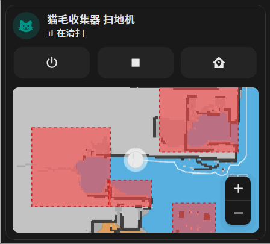

# Miot Vacuum Map

本项目是基于 Mushroom 的社区分支，由社区第三方开发者使用 AI 创建，不由 Mushroom 项目或其维护者维护。本项目不承诺永久可靠或持续可用。

Home Assistant 扫地机器人地图集成与 Lovelace 卡片，提供地图缩放、拖动、机器人跟随、清扫轨迹、房间和禁区显示，以及扫地机操作按钮。

后端通过 Xiaomi Miot 获取地图，前端使用独立的 `miot-map-` 组件。地图解析与渲染代码包含在本仓库中。

## 演示



## 地图支持列表

以下列表按设备的 Miot 型号标识记录已确认可用的型号。

| 设备型号（Miot model） | 地图支持状态 | 确认方式 |
| --- | --- | --- |
| `xiaomi.vacuum.c101` | 已确认可用 | 用户实机确认 |

其他型号尚未验证。Xiaomi Miot 能控制某款扫地机器人，不代表本项目也支持其地图协议。欢迎提供设备型号和实机验证结果，以补充此列表。

## 安装

先安装并配置 [Xiaomi Miot](https://github.com/al-one/hass-xiaomi-miot)，添加扫地机器人实体。

1. 将 `custom_components/miot_vacuum_map` 复制到 Home Assistant 的 `/config/custom_components/`。
2. 在 `configuration.yaml` 添加：

   ```yaml
   miot_vacuum_map:
   ```

3. 将 `frontend/dist/miot-vacuum-map.js` 复制到 `/config/www/miot-vacuum-map/`。
4. 在仪表盘资源中添加 `/local/miot-vacuum-map/miot-vacuum-map.js`，类型选择 **JavaScript Module**。
5. 重启 Home Assistant，添加卡片：

   ```yaml
   type: custom:miot-map-vacuum-card
   entity: vacuum.your_xiaomi_miot_vacuum
   show_map: true
   commands:
     - start_pause
     - stop
     - locate
     - return_home
   ```

## 配置

| 字段 | 说明 |
| --- | --- |
| `entity` | Xiaomi Miot 扫地机器人实体 |
| `show_map` | 是否显示地图，默认为 `false` |
| `commands` | 操作按钮：`start_pause`、`stop`、`locate`、`return_home` |

卡片支持可视化编辑器。启用地图后，通过 `miot_vacuum_map/get_map` WebSocket 接口加载数据。

## 构建与测试

在 `frontend` 目录执行：

```sh
npm ci
npm run typecheck
npm run build
```

构建产物为 `frontend/dist/miot-vacuum-map.js`。

在仓库根目录执行后端测试：

```sh
python -m pip install -r requirements-test.txt
python -m unittest discover -s tests
```

## 许可证

[Apache-2.0](LICENSE)。第三方代码来源与版权声明见 [NOTICE](NOTICE) 和 [THIRD_PARTY_LICENSES](THIRD_PARTY_LICENSES)。
